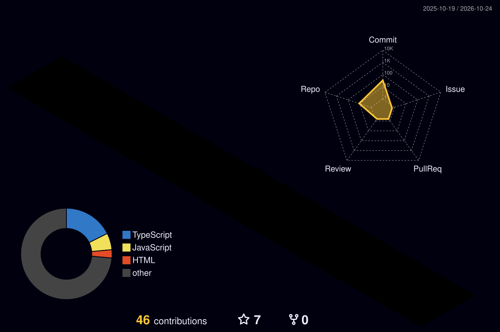

<!-- HEADER BANNER -->

  

<!-- TYPING ANIMATION -->

 

<!-- CONTACT BADGES -->

  
  
  

  
  

---

### 👨‍💻 About Me

🎓 Final-year Computer Science student with a strong foundation in Java and software development

💻 Java Full Stack Developer building scalable web applications with Spring Boot, MongoDB and React

🔭 Currently working on **AEQDF**, a machine-learning system that detects QR-code phishing (quishing)

🌱 Continuously learning System Design, Microservices and DevOps

🤝 Open to collaborating on full-stack projects and looking for entry-level Java Developer roles
---

### 🛠️ Tech Stack

  

---

### 📌 Featured Projects

| Project | Description | Tech Stack |
|---------|-------------|------------|
| [AEQDF Quishing Detection](https://github.com/sum347173-creator/aeqdf-quishing-detection) | ML-based detection of malicious QR-code phishing | Python, scikit-learn, FastAPI, Node.js |
| [ShopEasy](https://github.com/sum347173-creator/Shope-Easy-react--project) | Full-stack e-commerce application | React, Spring Boot, JSP, MySQL |
| [Task Blast](https://github.com/sum347173-creator/taskblast) | Team task management system | JavaScript, Tailwind CSS, Supabase |
| [Trello Clone](https://github.com/sum347173-creator/trello-clone) | Trello clone with frontend and backend | TypeScript, Supabase |
| [Vloora E-commerce](https://github.com/sum347173-creator/VLOORA-E-COMM-CLONE) | E-commerce website clone | HTML, JavaScript, Tailwind CSS |
| [PW Skills Page](https://github.com/sum347173-creator/PW-Page-clone-project) | PW Skills landing page clone | HTML, Tailwind CSS |
| [BMI Calculator](https://github.com/sum347173-creator/Bmi--Calculator) | BMI calculator | HTML, CSS, JavaScript |
| [Colour Changer](https://github.com/sum347173-creator/PROJECT-FIRST) | Changes the background colour when a container is clicked | HTML, CSS, JavaScript |

---

### 📊 GitHub Stats

  
  &nbsp;
  

  

---

### 🧊 3D Contribution Graph

  

---

  <i>"Code is not just syntax — it's the bridge between ideas and reality."</i>

